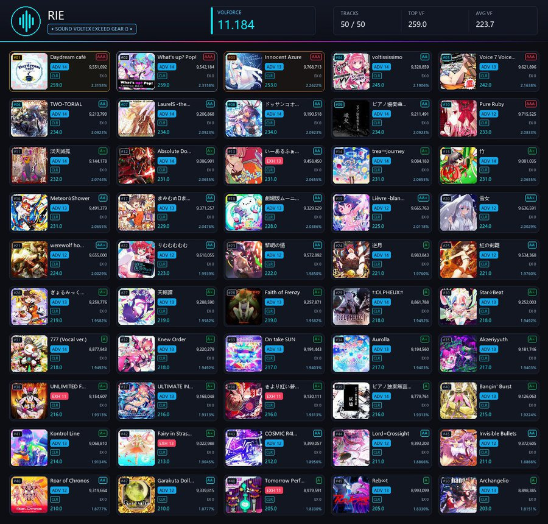

# Sound Voltex asphyxia Best50 Generator

<p align="center">
  
  
  
  
  
</p>

> 专门为 BEMANI 音步游戏 **SOUND VOLTEX EXCEED GEAR / ∇** 打造的高颜值 Best 50 战绩成绩卡与交互式网页生成器。

从 [asphyxia-core](https://github.com/asphyxia-core) 氧无本地存档中提取玩家全曲目成绩，自动按 `(mid, type)` 去重并按 **VOLFORCE (VF)** 降序筛选出 Top 50 个人最佳谱面，生成赛博街机风格的高清 JPEG 战绩图以及自包含响应式 HTML 战报。

---

## 📸 视觉预览



---

## ✨ 核心亮点

- 🎨 **Cybernetic Obsidian 赛博黑曜石美学**
  - **街机玩家 HUD 顶栏**：霓虹声纹头像环、大号数字 VOLFORCE 专属铭牌、Dan 段位徽章，以及总曲数、Top VF、平均 VF 等关键统计。
  - **领奖台专属高光**：前三名（#01 金、#02 银、#03 铜）配备专属高光微质感边框与高亮名次标牌。
  - **双层包边封面**：卡片采用 Nested Bezel 设计，封面居左浮动，右侧数据区空间充裕且层级分明。
  - **细致的街机元素**：内嵌 S/AAA/AA/A 专属分级徽章、通关状态灯（PUC/UC/EXC/CLR）、千分位格式化分数以及无封面时的自适应赛博棱镜备用图。
- ⚡ **超轻量高清画质**
  - 保持 **1200px** 黄金宽度，通过渐进式 JPEG 算法优化，单张卡片仅 **~400KB**（相比原版 5.2MB PNG 缩减 **90%+**），极速传输与分享。
- 📈 **VOLFORCE 贡献度精准分析**
  - 单曲卡片精准展示单曲 VF 及其对总 VOLFORCE 的百分比贡献（精确至小数点后 4 位，如 `250.0 ·12.3456%`）。
- 🌐 **交互式自包含 HTML 仪表盘**
  - 单文件自包含（无外部网络依赖），内嵌高压缩封面缩略图，体积从原版 11MB 骤减至 **~400KB**。
  - 支持**实时搜索曲名**、**难度胶囊分类筛选**（ALL / NOV / ADV / EXH / MXM / INF）以及**数据表格 / 卡片网格**双视图无缝切换。
- 💡 **一键开箱即用 & 内置 Demo**
  - 双击即可在当前目录自动探测游戏文件运行；提供 `--demo` 演示模式，无需本地存档也可随时预览生成。

---

## 🚀 快速上手

### 1. 下载可执行文件

从 [Releases](https://github.com/ChibaRie/sdvx_asphyxia_best_50/releases) 下载最新版 `SDVX_B50.exe`。

### 2. 双击运行

将 `SDVX_B50.exe` 放置于**游戏根目录**下（与 `asphyxia/` 和 `contents/` 文件夹同级），直接双击运行：

```text
📁 你的游戏根目录\
├── 📁 asphyxia\          ← 氧无服务端文件夹
├── 📁 contents\          ← 游戏资源文件夹（包含音乐与封面）
├── 📄 SDVX_B50.exe       ← 放置于此，双击运行 ✨
└── 📁 b50_output\        ← 自动生成输出目录
    ├── 🖼️ b50.jpg        # 赛博黑曜石 Best 50 战绩图（1200px 宽度，~400KB）
    └── 🌐 b50.html       # 交互式 HTML 仪表盘（带搜索、筛选、双视图）
```

---

## 🛠️ 命令行高级用法

支持自定义文件路径及快速生成 Demo：

```bash
# 生成内置样本数据（无需游戏存档）
SDVX_B50.exe --demo [输出目录]

# 查看命令行帮助
SDVX_B50.exe --help

# 手动指定游戏路径
SDVX_B50.exe [存档路径] [曲目数据库路径] [音乐资源目录] [输出目录]
```

### 默认路径一览

| 参数 | 默认位置 |
|------|----------|
| **玩家存档** | `./asphyxia/savedata/sdvx@asphyxia.db` |
| **曲目 MDB** | `./asphyxia/plugins/sdvx@asphyxia/webui/asset/json/music_db.json` |
| **音乐封面** | `./contents/data/music` |
| **生成目录** | `./b50_output/` |

---

## 📊 输出规格

| 项目 | 规格参数 |
|------|----------|
| **JPEG 卡片网格** | 1200 × ~1147 px，渐进式 JPEG（Quality 88，体积 ~400KB） |
| **卡片排布** | 5 列 × 10 行，5:2 比例卡片，浮动正方形封面与层次化数据展示 |
| **HTML 仪表盘** | 单文件自包含，内嵌轻量 Base64 缩略图（~400KB），支持打印与移动端自适应 |
| **展示信息** | 封面、曲名、难度徽章、等级、SCORE、EX SCORE、GRADE、通关状态、VOLFORCE 及贡献占比 |

---

## 🏗️ 项目架构

```text
├── src/                # 核心源代码目录
│   ├── __init__.py
│   ├── gen_b50.py      # 程序入口：CLI 解析、流水线编排、Demo 模式
│   ├── b50data.py      # 数据逻辑：asphyxia DB 解析、Top 50 选取、MDB 关联与封面定位
│   ├── render_png.py   # 渲染核心：1200px 赛博黑曜石卡片网格 JPEG 渲染器
│   ├── render_html.py  # 渲染核心：自包含交互式响应式 HTML 仪表盘生成器
│   └── sample_data.py  # 内置 50 首真实样本数据集（用于 Demo 与资产生成）
├── scripts/            # 工具与维护脚本
│   └── generate_assets.py # 预览图生成工具（一键刷新 assets/）
├── tests/              # 自动化测试套件（pytest 39 项全覆盖）
│   ├── conftest.py
│   ├── test_b50data.py
│   ├── test_render_html.py
│   └── test_render_png.py
├── assets/             # 静态资产与展示样本
│   ├── fonts/          # 渲染字体（微软雅黑 msyh.ttc）
│   │   └── msyh.ttc
│   ├── covers/         # 样本曲目封面缓存
│   ├── b50.jpg         # 完整 50 曲输出样本
│   └── preview_sm.jpg  # README 预览图
├── requirements.txt    # Python 运行时依赖清单
├── SDVX_B50.spec       # PyInstaller 单文件打包规范
└── CHANGELOG.md        # 版本更新历史记录
```

---

## 💻 从源码构建

```bash
# 1. 克隆仓库
git clone https://github.com/ChibaRie/sdvx_asphyxia_best_50.git
cd sdvx_asphyxia_best_50

# 2. 安装依赖
pip install -r requirements.txt pyinstaller pytest

# 3. 运行测试
pytest

# 4. 执行打包
pyinstaller SDVX_B50.spec

# 5. 生成结果位于 dist/SDVX_B50.exe
```

---

## 🔗 相关项目

- [asphyxia-core](https://github.com/asphyxia-core/core) — 游戏本地服务端核心
- [sdvx@asphyxia](https://github.com/22vv0/asphyxia_plugins) — SDVX 插件与 WebUI

---

## 📄 开源协议

本项目采用 [MIT License](LICENSE) 授权许可。
